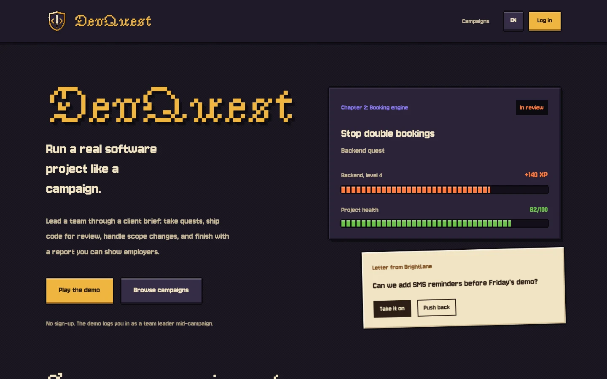
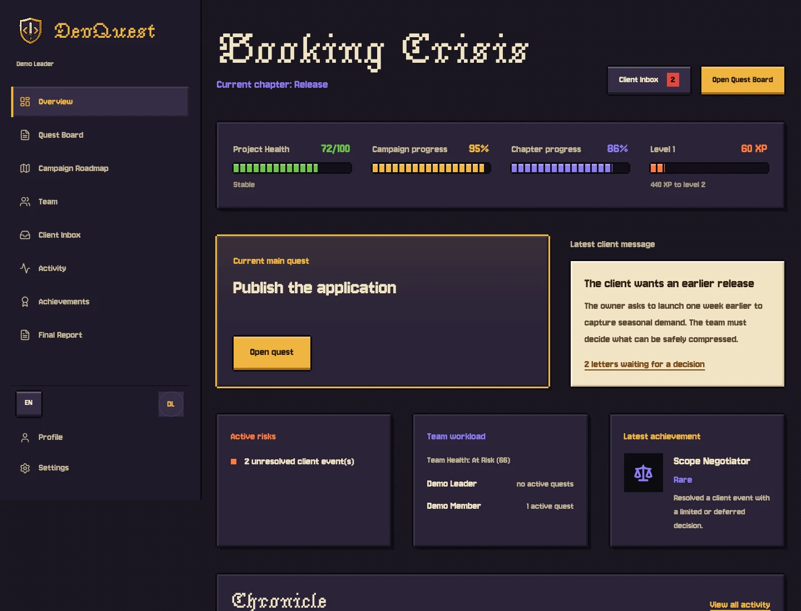
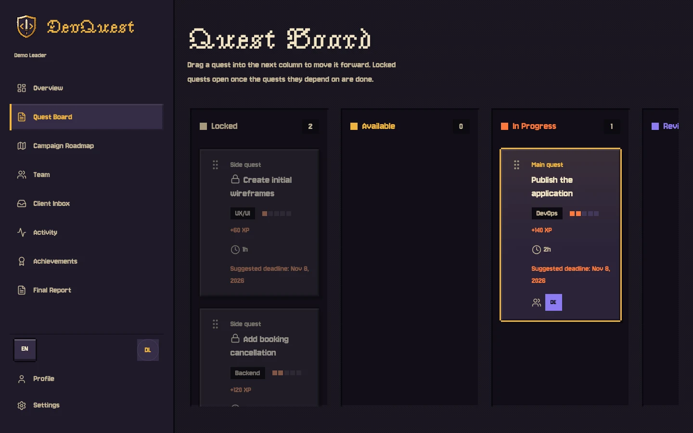
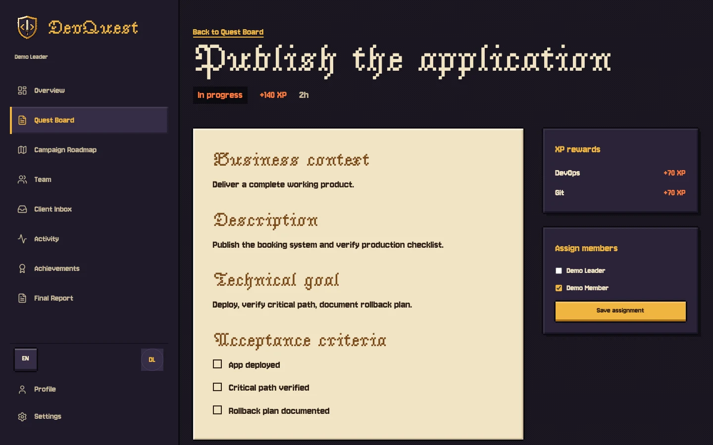
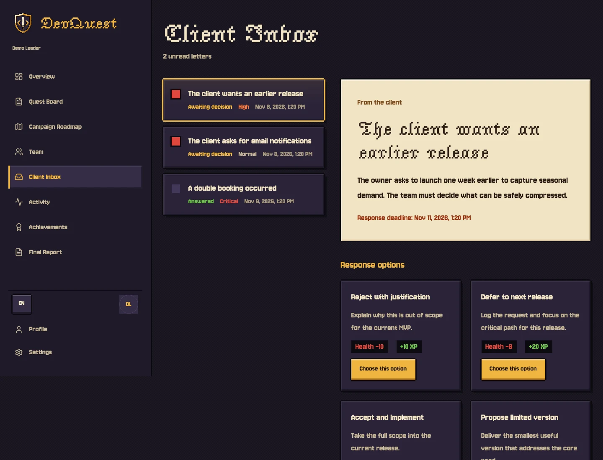
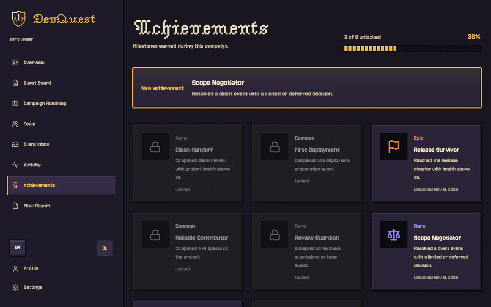
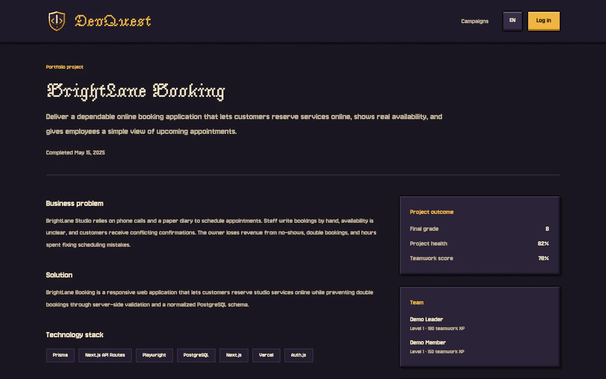
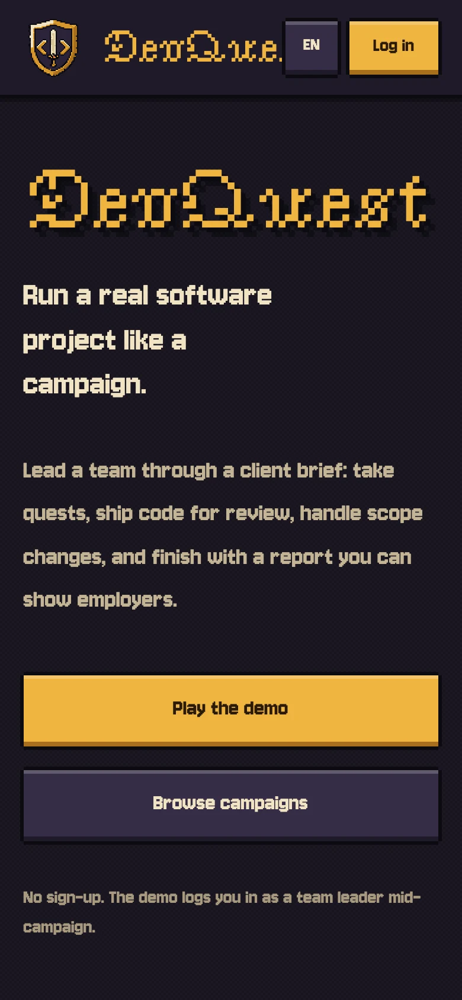

<p align="center">
  
</p>

<h1 align="center">DevQuest</h1>

<p align="center">
  Run a real software project like a campaign: quests, code review, client decisions and a portfolio-ready final report.
</p>

<p align="center">
  <a href="https://github.com/szymonzamachowski/DevQuest/actions/workflows/ci.yml"></a>
  <a href="https://github.com/szymonzamachowski/DevQuest/actions/workflows/e2e.yml"></a>
</p>

<p align="center">
  
</p>

> **Status: work in progress.** The MVP below is implemented and covered by unit (Vitest) and end-to-end (Playwright) tests in CI. A public demo is not deployed yet.

---

## Problem

Junior developers and CS students rarely get realistic, portfolio-ready project experience. Coursework skips most of the delivery loop: scoping, teamwork, client communication, code review, quality trade-offs and release.

## Solution

DevQuest turns that loop into a game. A team (or a solo player) runs a structured client project as a campaign: quests unlock as dependencies are met, submissions go through leader review, XP flows into skills, client letters force decisions that move project health, and the campaign ends with a deterministic final report and an optional public portfolio page.

## Screenshots

| Campaign dashboard                                                                                                       | Quest board                                                                                                   |
| ------------------------------------------------------------------------------------------------------------------------ | ------------------------------------------------------------------------------------------------------------- |
|  |      |
| **Quest brief**                                                                                                          | **Client inbox**                                                                                              |
|               |  |
| **Achievements**                                                                                                         | **Public portfolio page**                                                                                     |
|                                        |          |

<p align="center">
  
</p>

## Features (MVP)

- **Campaign catalog**: browse published simulations (e.g. _Booking Crisis_)
- **Project setup**: solo or team mode, role selection, stack assessment
- **Quest workflow**: Kanban board with drag and drop, GitHub commit/PR submissions, leader review
- **XP and skills**: deterministic XP awards mapped to skill categories and user levels
- **Project health**: rule-based changes from delivery and client events
- **Client inbox**: timed client letters; each response option shows its health and XP impact
- **Achievements**: milestone unlocks with rarity
- **Campaign completion**: leader or solo finalization with repository and demo URLs
- **Final report**: deterministic team and individual reports (no AI)
- **Public project page**: recruiter-friendly portfolio view
- **Demo mode**: no sign-up; every visitor gets a private copy of a mid-campaign project, removed after 24 hours
- **i18n**: English and Polish (`next-intl`)

## Tech stack

| Layer         | Technology                                                           |
| ------------- | -------------------------------------------------------------------- |
| Framework     | Next.js 16 (App Router), React 19, TypeScript (strict)               |
| Styling       | Tailwind CSS 4, shadcn/ui primitives, custom pixel-art design system |
| Database      | PostgreSQL (Supabase), Prisma ORM                                    |
| Auth          | NextAuth v4 credentials provider, bcrypt password hashing            |
| i18n          | next-intl (EN / PL)                                                  |
| Drag and drop | @dnd-kit (quest board)                                               |
| Unit tests    | Vitest, Testing Library                                              |
| E2E tests     | Playwright                                                           |
| CI            | GitHub Actions                                                       |

## Architecture

```
src/
├── app/                    # App Router routes (public + /app workspace)
├── components/             # Shared UI, layout shell, brand
├── features/               # Feature modules (campaigns, quests, inbox, completion…)
├── lib/                    # Services, permissions, DB, auth helpers
├── config/                 # Health rules, stack rules
├── messages/               # i18n dictionaries (en, pl)
└── types/                  # Shared TypeScript types

prisma/
├── schema.prisma           # Data model
├── migrations/             # SQL migrations
└── seed.ts                 # Skills, campaigns, demo users and projects
```

**High-level flow**

1. User registers or logs in, then browses the campaign catalog
2. Leader starts setup (mode, team, roles, stack) and the project becomes `ACTIVE`
3. Quests unlock by dependencies; assign, submit via GitHub URL, review, earn XP
4. Client events trigger from progress; leader resolves them with health and scope effects
5. Leader completes the campaign, generates the final report, and optionally publishes a public slug

## Data model (overview)

Core entities: `User`, `CampaignTemplate`, `Project`, `ProjectMember`, `ProjectQuest`, `QuestSubmission`, `ProjectClientEvent`, `ProjectActivity`, `Achievement`, `UserSkill`, `FinalReport`, `UserFinalReport`.

See [`prisma/schema.prisma`](prisma/schema.prisma) for the full schema.

## Key technical decisions

- **Game rules are pure functions.** XP, levels, project health, quest unlocking and completion eligibility live in `src/lib/services` and `src/lib/xp-level.ts` as deterministic functions with unit tests, separate from database access. The same input always gives the same report, which makes the scoring explainable.
- **Permissions are checked on the server.** Every project-scoped Server Action goes through `src/lib/permissions` (leader, member, solo self-review) before touching data; the UI only hides what the server would reject anyway.
- **Server Components by default.** Pages fetch data on the server; client components are limited to interactive parts such as the drag-and-drop board, the inbox and forms.
- **Supabase as plain Postgres.** The app talks to the database only through Prisma (transaction pooler at runtime, session pooler for migrations). Row level security is enabled on every table with no policies, so Supabase's public Data API cannot read anything (`prisma/migrations/0007_enable_rls`).
- **Hydration-safe i18n.** Dates are formatted through `next-intl` with a fixed time zone, so server and browser render identical text.
- **A small design system instead of a template.** Colour tokens, sprite-style panels, segmented meters and press-down buttons are built with CSS `box-shadow` in `src/app/globals.css` and `src/components/ui`. Fonts were picked for legibility at small sizes (Jersey 10 for UI, Jacquarda Bastarda 9 for titles).
- **Shared state lives in Postgres.** Rate limits use an atomic upsert on a `RateLimitBucket` table, because in-memory counters reset per serverless instance.
- **Tests at two levels.** Vitest covers the rules and permissions; Playwright plays a full team campaign (submit, review, client decision, completion, public page) against a real Postgres in CI.

## Local setup

### Prerequisites

- Node.js 20.9+ (24 recommended, see `.nvmrc`)
- A PostgreSQL database — a free [Supabase](https://supabase.com) project works out of the box, no Docker required

### 1. Install dependencies

```bash
npm install
```

### 2. Create a database (Supabase, no Docker)

1. Create a free project at [supabase.com](https://supabase.com) and save the database password.
2. Open **Connect → ORMs → Prisma** in the project dashboard and copy the two connection strings:
   - **Transaction pooler** (port `6543`) → `DATABASE_URL`
   - **Session pooler** (port `5432`) → `DIRECT_URL`, used only by Prisma Migrate

> Prefer a local database? `docker compose up -d` starts Postgres 16; use the local URLs from `.env.example` for both variables.

### 3. Environment variables

```bash
cp .env.example .env
```

Paste both connection strings into `.env` and set a strong `AUTH_SECRET`:

```bash
openssl rand -base64 48
```

### 4. Database migrate and seed

```bash
npm run prisma:generate
npm run db:deploy
npm run db:seed
```

To wipe the database and start over (also re-runs the seed): `npm run db:reset`.

### 5. Run the app

```bash
npm run dev
```

Open [http://localhost:3000](http://localhost:3000).

## Environment variables

| Variable               | Required   | Description                                        |
| ---------------------- | ---------- | -------------------------------------------------- |
| `DATABASE_URL`         | Yes        | Runtime connection (Supabase transaction pooler)   |
| `DIRECT_URL`           | Yes        | Migration connection (Supabase session pooler)     |
| `AUTH_SECRET`          | Yes        | Session signing secret (long random string)        |
| `NEXTAUTH_URL`         | Production | Public app URL, e.g. `https://your-domain.com`     |
| `DEMO_TEMPLATE_LOCKED` | Production | `true` makes the seeded template project read-only |
| `CRON_SECRET`          | Production | Bearer token for the daily sandbox cleanup job     |
| `E2E_SKIP_SEED`        | No         | Set to `1` to skip Playwright global seed          |

## Demo mode

**Play the demo** (landing page and `/login`) needs no sign-up. Each click creates a private sandbox:

1. `startDemoAction` checks two rate limits stored in Postgres (per visitor, by hashed IP, and global).
2. `createDemoSandbox` creates a guest leader and a guest teammate and copies the seeded mid-campaign project (`demo-team-active-project`) with its quests, assignments, client letters, activity and achievements in one transaction. All timestamps are shifted so deadlines stay in the future.
3. The action returns a short-lived HMAC-signed token; a separate NextAuth `guest` credentials provider exchanges it for a session. No password is ever sent to the browser.
4. Guests can play the whole campaign, but cannot publish a public portfolio page.
5. A daily Vercel Cron job (`/api/cron/cleanup-guests`) deletes sandboxes older than 24 hours.

With `DEMO_TEMPLATE_LOCKED=true` the template itself is read-only, so nobody can change what future visitors get.

### Seeded accounts (local development)

Password for all seeded users: **`devquestdemo`**

| Email                        | Role                              |
| ---------------------------- | --------------------------------- |
| `demo.leader@devquest.local` | Team leader (active demo project) |
| `demo.member@devquest.local` | Team member                       |
| `demo.solo@devquest.local`   | Solo completed campaign           |

Completed public portfolio: `/projects/brightlane-booking`

## Testing

```bash
npm run lint
npm run format
npm run typecheck
npm test
npm run e2e
npm run build
```

Playwright global setup runs migrations and seed automatically unless `E2E_SKIP_SEED=1`.

## CI

| Workflow | File                        | Steps                                               |
| -------- | --------------------------- | --------------------------------------------------- |
| CI       | `.github/workflows/ci.yml`  | install, format, lint, typecheck, unit tests, build |
| E2E      | `.github/workflows/e2e.yml` | Postgres service, migrate, seed, Playwright         |

## Deployment (Vercel + Supabase)

1. Run migrations and the seed against the production database once:
   `npm run db:deploy && npm run db:seed` (with that database's URLs in `.env`).
2. Import the GitHub repository in Vercel (framework preset: Next.js).
3. Set environment variables: `DATABASE_URL` (transaction pooler, `connection_limit=5`), `DIRECT_URL`, `AUTH_SECRET`, `NEXTAUTH_URL` (the Vercel URL), `DEMO_TEMPLATE_LOCKED=true` and `CRON_SECRET`.
4. `vercel.json` pins functions to `fra1` (Frankfurt), next to the Supabase `eu-central-1` database; change both together.
5. Deploy. `vercel.json` registers the daily cleanup cron automatically.

Later schema changes: run `npm run db:deploy` against production before deploying code that needs them.

## MVP limitations

Not implemented in this MVP:

- AI-generated content or code analysis
- Payments or subscriptions
- Real-time chat or WebSockets
- Full GitHub OAuth (URL parsing and metadata only)
- University or instructor admin panel
- Campaign creator UI (campaigns are seeded via Prisma)
- Matchmaking
- Automatic code execution or sandbox

## Roadmap (post-MVP)

- Additional campaign templates
- GitHub OAuth integration
- Instructor or cohort analytics
- Notification delivery (email)
- Campaign authoring UI
- Richer portfolio media uploads

## License

[MIT](LICENSE)
